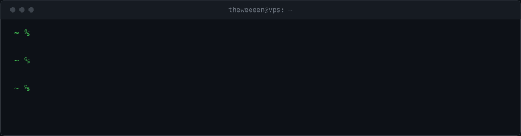
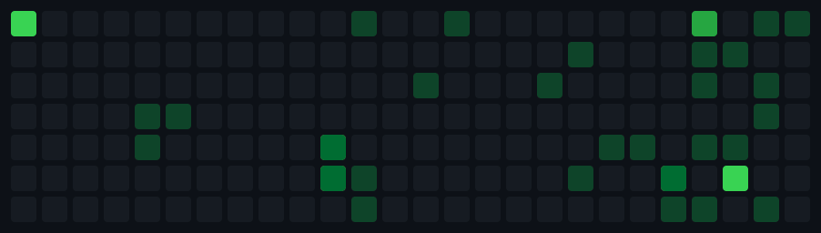

# TheWeeeen

Backend & automation engineer. C++ / Rust / Go / TypeScript. Networks, drivers, AI
systems — self-hosted, no cloud.

## Projects

**Tunnels & VPN**
[hydrat](https://github.com/TheWeeeen/hydrat) — WireGuard gateway with automatic
VLESS/Tor routing, onion and I2P access, web panel.
[claude-tunnel](https://github.com/TheWeeeen/claude-tunnel) — keeps Claude Code and
the browser inside your own REALITY tunnel, fail-closed.
[olcrtc-setup](https://github.com/TheWeeeen/olcrtc-setup) — WebRTC tunnel on a VPS
in one command: build, configs, systemd, host benchmark.

**AI**
[llmhub](https://github.com/TheWeeeen/llmhub) — OpenAI-compatible router pooling
free LLM tiers, with per-model quota accounting and failover.
[easyrag](https://github.com/TheWeeeen/easyrag) — RAG over production documentation:
citations, projects with isolated search, CLI.
[opencode-free-api](https://github.com/TheWeeeen/opencode-free-api) — local
OpenAI-compatible API to free OpenCode models, no dependencies.

**Automation**
[questline](https://github.com/TheWeeeen/questline) — Discord quest runner, Rust core
with tests and a port-based architecture.
[mimic-discord](https://github.com/TheWeeeen/mimic-discord) /
[mimic-quests](https://github.com/TheWeeeen/mimic-quests) — activity spoofer and its
quest-mode fork.
[torrvio](https://github.com/TheWeeeen/torrvio) — torrent video player: instant
playback, seek, subtitles.

**Linux**
[uxplay-easy](https://github.com/TheWeeeen/uxplay-easy) — AirPlay receiver for Linux in
one click, GTK3.
[cachyos-niri-setup](https://github.com/TheWeeeen/cachyos-niri-setup) — clean niri +
Noctalia install and data migration.

## Stack

- **Low-level** — C++, Rust, Linux internals, drivers, network protocols
- **High-level** — TypeScript, Java, Python, Go
- **Infra** — Linux, systemd, nginx, WireGuard/VLESS, Docker
- **AI** — RAG, LLM routing, pipelines

## Contributions

---

Русская версия: [README.ru.md](README.ru.md)
