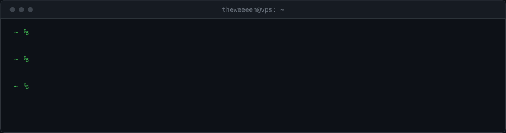

# TheWeeeen

Бэкенд и автоматизация. C++ / Rust / Go / TypeScript. Сети, драйверы, AI-системы —
на своих серверах, без облака.

## Стек

- **Низкий уровень** — C++, Rust, Linux internals, драйверы, сетевые протоколы
- **Высокий уровень** — TypeScript, Java, Python, Go
- **Инфраструктура** — Linux, systemd, nginx, WireGuard/VLESS, Docker
- **AI** — vLLM, llama.cpp, запуск моделей, RAG, роутинг LLM, эмбеддинги, пайплайны

## Активность

---

English version: [README.md](README.md)
