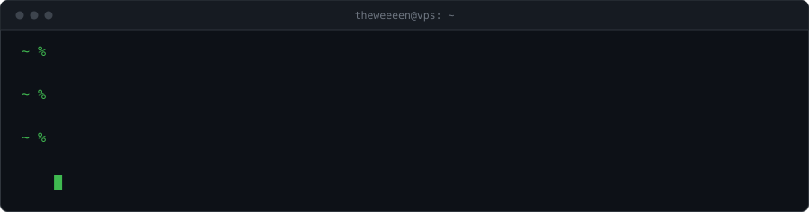
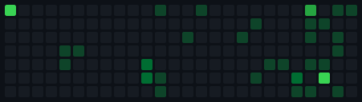

# TheWeeeen

Бэкенд и автоматизация. C++ / Rust / Go / TypeScript. Сети, драйверы, AI-системы —
на своих серверах, без облака.

## Проекты

**Туннели и VPN**
[hydrat](https://github.com/TheWeeeen/hydrat) — шлюз на WireGuard с автовыбором
VLESS/Tor, доступом к onion и I2P, веб-панелью.
[claude-tunnel](https://github.com/TheWeeeen/claude-tunnel) — держит Claude Code и
браузер внутри своего REALITY-туннеля, fail-closed.
[olcrtc-setup](https://github.com/TheWeeeen/olcrtc-setup) — WebRTC-туннель на VPS
одной командой: сборка, конфиги, systemd, бенчмарк хостов.

**AI**
[llmhub](https://github.com/TheWeeeen/llmhub) — OpenAI-совместимый роутер над
бесплатными тирами моделей: учёт квот по каждой модели, failover.
[easyrag](https://github.com/TheWeeeen/easyrag) — RAG по производственной
документации: цитаты, проекты с изолированным поиском, CLI.
[opencode-free-api](https://github.com/TheWeeeen/opencode-free-api) — локальный
OpenAI-совместимый API к бесплатным моделям OpenCode, без зависимостей.

**Автоматизация**
[questline](https://github.com/TheWeeeen/questline) — Discord quest runner: ядро на
Rust, тесты, портовая архитектура.
[mimic-discord](https://github.com/TheWeeeen/mimic-discord) /
[mimic-quests](https://github.com/TheWeeeen/mimic-quests) — спуфер активности и его
форк с режимом квестов.
[torrvio](https://github.com/TheWeeeen/torrvio) — торрент-плеер: мгновенный старт,
перемотка, субтитры.

**Linux**
[uxplay-easy](https://github.com/TheWeeeen/uxplay-easy) — AirPlay-приёмник для Linux
в один клик, GTK3.
[cachyos-niri-setup](https://github.com/TheWeeeen/cachyos-niri-setup) — чистая
установка niri + Noctalia и перенос данных.

## Стек

- **Низкий уровень** — C++, Rust, Linux internals, драйверы, сетевые протоколы
- **Высокий уровень** — TypeScript, Java, Python, Go
- **Инфраструктура** — Linux, systemd, nginx, WireGuard/VLESS, Docker
- **AI** — RAG, роутинг LLM, пайплайны

## Активность

---

English version: [README.md](README.md)
